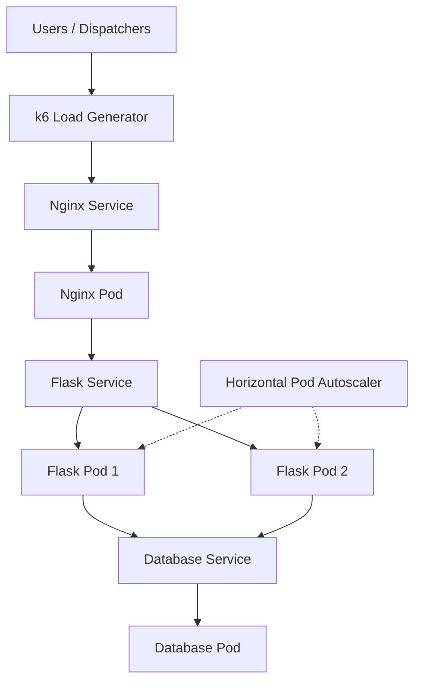

# Statustracker Architecture

## 1.Overview

Statustracker is a web application that is used by Harborlight Logistics 
to help plan, manage, and track operational incidencts. 

The Application has three primary components:

- Nginx: Takes care of the incoming HTTP requests. 
- Flask: Processes the application requests.
- Database: Allows storage of the application data. 

The system will run inside the Kubernetes cluster using k3d application.

## Architecture Diagram

## Application Components

### Nginx

- Acts as the HTTP entry point.
- Routes requests coming to the Flask.
- Runs inside Kubernetes.

### Flask

- Handles the logic of the business applcation.
- Gathers incident submissions.
- Communicates with the database.
- Scales automatically using Kubernetes HPA.

### Database

- Stores the application records.
- Receives requests into the database from the flask.

## Kubernetes Networking

Services provide stable networking endpoints 
with communcation between application components 

## Network Policies

Network Policies must restrict communication between application components. 

- Nginx -> Flask
- Flask -> Database
- Required DNS traffic -> Cluster DNS

Any unauthorized communication should be blocked. 

Some example DNS names:

- nginx-service.namespace.svc.cluster.local
- flask-service.namespace.svc.cluster.local
- database-service.namespace.svc.cluster.local

Actual names must go through the Kubernetes cluster to be verified against. 

Success criteria: 

- Flask will automatically scale to at lease two replicas.
- Load test will generate at least 3x baseline traffic.
- Node failure should run for at least 3 minutes.
- HTTP request should fail less than 1% of the time. 

## What We Changed and Why
Routes and pages. New API endpoints, a JSON version of a page, a search or filter, a ticket detail view, a dashboard page.
The data model. New columns (category, severity, assignee, resolved_at), new tables (comments, audit log, users), indexes.
The generator and seed data. Write your own generator, give it realistic patterns, change what it produces.
New small services. A second container that does one job (a classifier, a summary endpoint, an exporter), with its own Service and NetworkPolicy.
Behavior. Validation, authentication, rate limiting, caching, a /ready endpoint that differs from /health, a /metrics endpoint.
The UI. Templates and styles, if your section's app has them.

