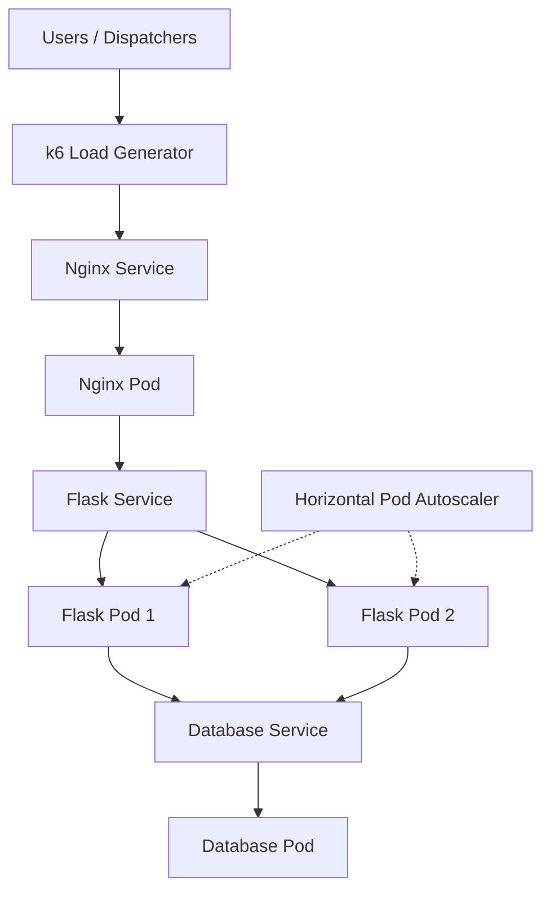

# Statustracker Architecture

## 1.Overview

Statustracker is a web application that is used by Harborlight Logistics 
to help plan, manage, and track operational incidencts. 

The Application has three primary components:

- Nginx: Takes care of the incoming HTTP requests. 
- Flask: Processes the application requests.
- Database: Allows storage of the application data. 

The system will run inside the Kubernetes cluster using k3d application.

## Architecture Diagram

## What We Changed and Why
Routes and pages. New API endpoints, a JSON version of a page, a search or filter, a ticket detail view, a dashboard page.
The data model. New columns (category, severity, assignee, resolved_at), new tables (comments, audit log, users), indexes.
The generator and seed data. Write your own generator, give it realistic patterns, change what it produces.
New small services. A second container that does one job (a classifier, a summary endpoint, an exporter), with its own Service and NetworkPolicy.
Behavior. Validation, authentication, rate limiting, caching, a /ready endpoint that differs from /health, a /metrics endpoint.
The UI. Templates and styles, if your section's app has them.
